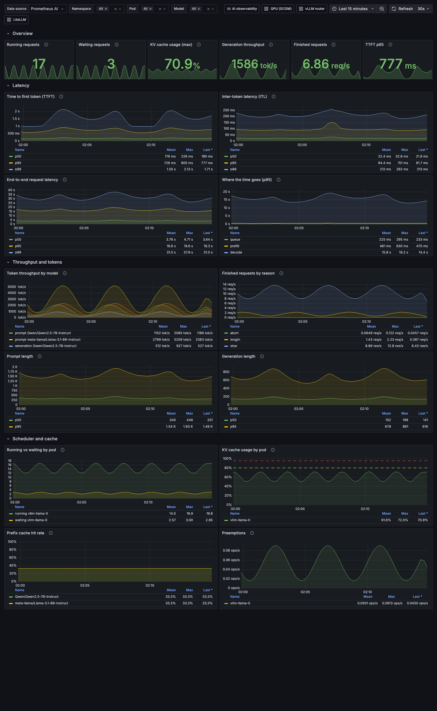
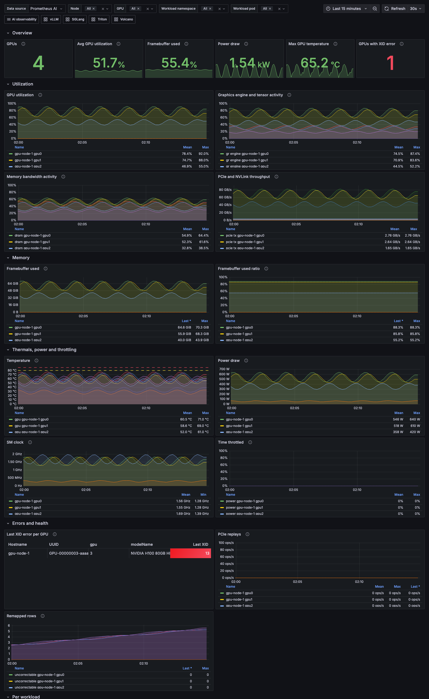
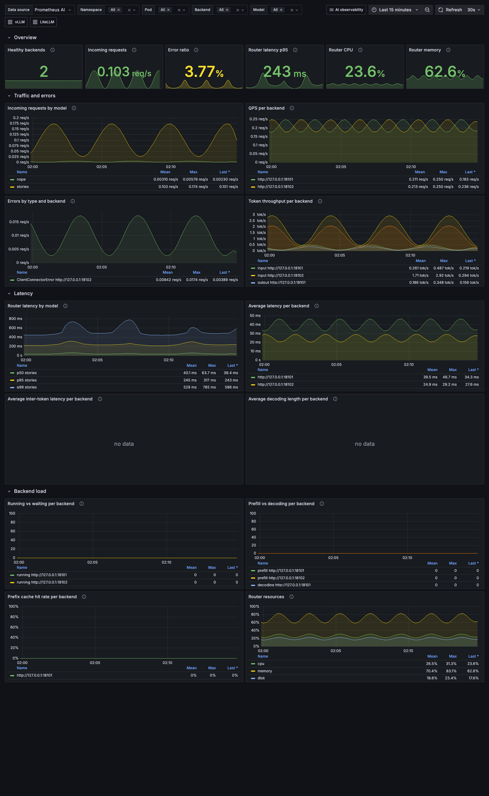
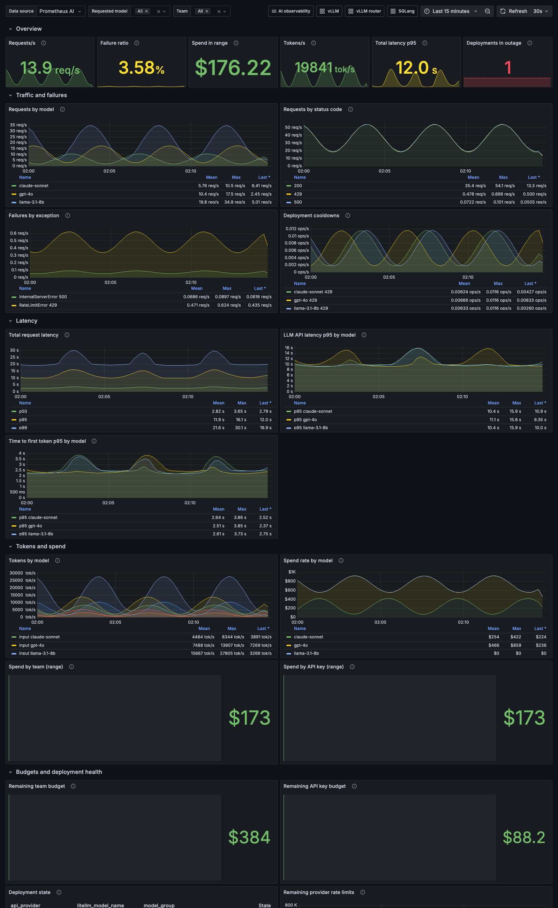
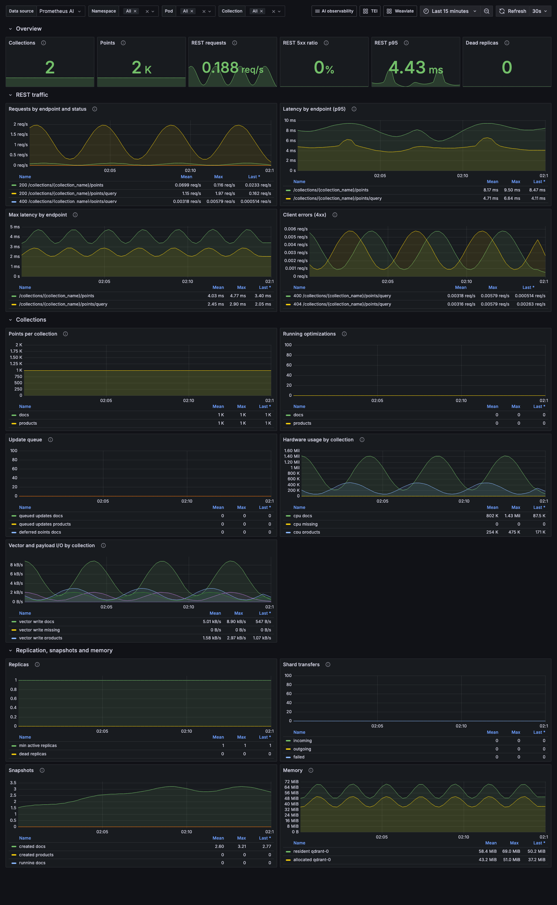
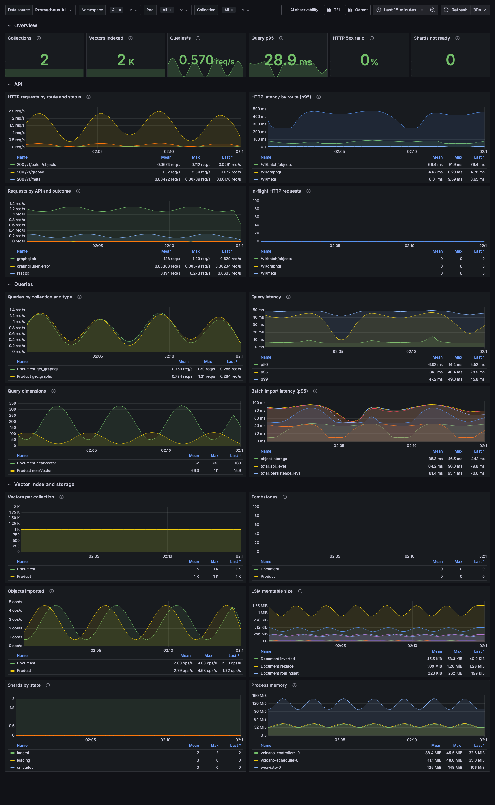

# AI observability pack

Grafana dashboards, Prometheus alerts and Zabbix templates for self-hosted AI inference: LLM engines, embedding servers, vector databases, model serving platforms, GPU telemetry, batch scheduling and LLM gateways.

Every query uses the metric names the projects actually expose (taken from their source code, docs or real `/metrics` captures), and every dashboard query and alert rule is tested against a Prometheus scraping those samples (see [Testing](#testing)).

## Contents

| Dashboard | File | Covers | Enable metrics |
|---|---|---|---|
| vLLM | [`dashboards/vllm.json`](dashboards/vllm.json) | TTFT, ITL, E2E latency, phase breakdown, token throughput, finish reasons, queue, KV cache, prefix cache, preemptions | on by default (`/metrics` on the API port) |
| vLLM production-stack router | [`dashboards/vllm-production-stack-router.json`](dashboards/vllm-production-stack-router.json) | healthy backends, QPS per backend, router errors and latency, per-backend load and prefix cache | on by default |
| SGLang | [`dashboards/sglang.json`](dashboards/sglang.json) | TTFT, ITL, E2E, queue time, throughput, aborts, token pool, radix cache | `--enable-metrics` |
| llama.cpp server | [`dashboards/llama-cpp.json`](dashboards/llama-cpp.json) | tokens/s, decode speed, slots and deferred requests, prompt cache, speculative decoding | `--metrics` |
| Hugging Face TEI | [`dashboards/hf-tei.json`](dashboards/hf-tei.json) | request rate, failures, latency breakdown (tokenization, queue, inference), batching, input length | on by default (port 9000) |
| NVIDIA Triton | [`dashboards/triton.json`](dashboards/triton.json) | success/failure by reason, latency breakdown, dynamic batching, pending requests, GPU/CPU | on by default (port 8002) |
| NVIDIA GPU (DCGM) | [`dashboards/nvidia-dcgm.json`](dashboards/nvidia-dcgm.json) | utilization, tensor/DRAM activity, memory, thermals, power, throttling, XID, row remapping, per-pod GPU usage | dcgm-exporter |
| Volcano | [`dashboards/volcano.json`](dashboards/volcano.json) | scheduling latency by action/plugin, unschedulable work, queue CPU/memory/GPU, pod groups, job outcomes, preemption | on by default |
| KServe / Knative | [`dashboards/kserve-knative.json`](dashboards/kserve-knative.json) | predict latency, queue-proxy traffic and 5xx, autoscaler desired vs actual pods, concurrency, panic mode | Knative Serving 1.19+ |
| Ray Serve | [`dashboards/ray-serve.json`](dashboards/ray-serve.json) | HTTP traffic and errors, deployment latency and exceptions, queueing, replica health, autoscaling, status | Ray metrics export |
| LiteLLM proxy | [`dashboards/litellm.json`](dashboards/litellm.json) | traffic, failures by exception, latency, TTFT, tokens, spend by model/team/key, budgets, deployment health | `callbacks: ["prometheus"]` |
| Qdrant | [`dashboards/qdrant.json`](dashboards/qdrant.json) | REST traffic and latency per endpoint, points per collection, optimizations and update queue, replicas and shard transfers, snapshots, memory | on by default (`/metrics` on 6333) |
| Weaviate | [`dashboards/weaviate.json`](dashboards/weaviate.json) | HTTP API by route, queries by collection and type, query dimensions, batch imports, HNSW size and tombstones, LSM memtables, shards | `PROMETHEUS_MONITORING_ENABLED=true` (port 2112) |

Every dashboard opens with a row of summary stats, has a `Data source` variable, Kubernetes `namespace`/`pod` filters (or the component's natural dimension: model, queue, application, GPU, collection), a unit and a description on every panel, thresholds on latency and error stats, a dropdown to the other dashboards of the pack plus direct links to related ones (vLLM to GPU and gateway, TEI to the vector databases...), and shows *no data* instead of a blank panel.

**Alerts:** 41 Prometheus alert rules in 13 groups, as a plain rules file and as a `PrometheusRule`, with a [runbook](alerts/RUNBOOK.md) and `promtool` unit tests. See [Alerts](#alerts).

**Zabbix:** templates for llama.cpp, vLLM and NVIDIA DCGM exporter using one HTTP agent item plus Prometheus preprocessing. See [Zabbix](#zabbix).

Ollama is not included: it does not expose Prometheus metrics, and none of the community exporters is established enough to target. Milvus, LocalAI and Infinity are not included yet because their metrics could not be captured from a running instance without downloading large images or models.

## Screenshots

Rendered from the test fixtures in [`test/fixtures`](test/fixtures) (see [Testing](#testing)), so the numbers are not from a real workload. The fixture server keeps its clock across restarts, so the graphs have no artificial spikes.

| | |
|---|---|
| vLLM  | NVIDIA GPU (DCGM)  |
| vLLM production-stack router  | LiteLLM  |
| Qdrant  | Weaviate  |

All screenshots: [`docs/screenshots`](docs/screenshots).

## Install the dashboards

Grafana UI: **Dashboards > New > Import**, upload the JSON file (or paste the grafana.com ID once published) and pick your Prometheus data source in the `Data source` dropdown at the top of the dashboard.

kube-prometheus-stack (Grafana sidecar):

```bash
for f in dashboards/*.json; do
  name=ai-obs-$(basename "$f" .json)
  kubectl -n monitoring create configmap "$name" --from-file="$f" --dry-run=client -o yaml \
    | kubectl label --local -f - grafana_dashboard=1 -o yaml \
    | kubectl apply -f -
done
```

Grafana Operator:

```yaml
apiVersion: grafana.integreatly.org/v1beta1
kind: GrafanaDashboard
metadata:
  name: ai-obs-vllm
spec:
  instanceSelector:
    matchLabels:
      dashboards: grafana
  url: https://raw.githubusercontent.com/lbarrosby/ai-observability-pack/main/dashboards/vllm.json
```

File provisioning: point a `providers` entry at a folder with the JSON files.

### Label conventions

- `namespace` and `pod` are the labels added by Prometheus Operator `ServiceMonitor`/`PodMonitor` and by the usual `kubernetes_sd_configs` relabeling. Outside Kubernetes the filters stay on *All* and match series without those labels.
- **dcgm-exporter** must be scraped with `honorLabels: true` (the GPU Operator default) so `namespace`/`pod` refer to the workload that owns the GPU, not to the exporter pod.
- **vLLM production-stack router** reuses the `vllm:` prefix. The engine dashboard only selects series with a `model_name` label and the router dashboard only selects series with a `server` or `model` label, so both can live in the same Prometheus.
- **Knative 1.19+** exports metrics through OpenTelemetry: queue-proxy metrics carry only `http_response_status_code` (resource attributes go to `target_info`), so they are filtered by the scrape labels `namespace`/`pod`; autoscaler metrics carry `k8s_namespace_name` and `kn_revision_name`.

## Alerts

```bash
# prometheus-operator / kube-prometheus-stack
# (add the label your Prometheus ruleSelector expects, e.g. release: kube-prometheus-stack)
kubectl apply -n monitoring -f alerts/ai-inference-prometheusrule.yaml

# plain Prometheus
#   rule_files: [ "alerts/ai-inference-rules.yaml" ]

# unit tests
promtool test rules alerts/tests/ai-inference-rules.test.yaml
```

| Group | Alerts |
|---|---|
| vllm | VLLMRequestsQueueing, VLLMKVCacheNearlyFull, VLLMPreemptions, VLLMHighTimeToFirstToken, VLLMHighAbortRatio |
| vllm-production-stack-router | VLLMRouterNoHealthyBackends, VLLMRouterHighErrorRatio |
| sglang | SGLangRequestsQueueing, SGLangTokenPoolNearlyFull, SGLangHighTimeToFirstToken |
| llama-cpp | LlamaCppRequestsDeferred |
| hf-tei | TEIQueueBacklog, TEIHighFailureRatio |
| triton | TritonHighFailureRatio, TritonPendingRequests |
| nvidia-dcgm | GPUXidError, GPUFatalXidError, GPUHighTemperature, GPUThermalThrottling, GPUPowerThrottling, GPURowRemapFailure, GPUUncorrectableRemappedRowsIncreasing, GPUPCIeReplays, GPUIdleWhileAllocated |
| volcano | VolcanoUnschedulableJobs, VolcanoSchedulingSlow, VolcanoJobsFailing |
| kserve-knative | KnativeRevisionCannotScale, KnativeQueueProxy5xx |
| ray-serve | RayServeDeploymentUnhealthy, RayServeHighErrorRatio, RayServeBackpressure |
| litellm | LiteLLMHighFailureRatio, LiteLLMDeploymentOutage, LiteLLMDeploymentDegraded, LiteLLMTeamBudgetLow |
| qdrant | QdrantDeadReplicas, QdrantHighErrorRatio |
| weaviate | WeaviateHighErrorRatio, WeaviateSlowQueries, WeaviateShardsNotReady |

Thresholds are starting points. Latency alerts in particular (TTFT p95 > 2s) should be set to your SLO. Throttling alerts need `DCGM_FI_DEV_THERMAL_VIOLATION` / `DCGM_FI_DEV_POWER_VIOLATION`, which are commented out in the default dcgm-exporter counters file.

## Zabbix

| Template | Folder | Discovery |
|---|---|---|
| llama.cpp server by HTTP | [`zabbix/template_llama_cpp_server_by_http/7.0`](zabbix/template_llama_cpp_server_by_http/7.0) | none (one server per host) |
| vLLM by HTTP | [`zabbix/template_vllm_by_http/7.0`](zabbix/template_vllm_by_http/7.0) | served models (`model_name`) |
| NVIDIA DCGM exporter by HTTP | [`zabbix/template_nvidia_dcgm_exporter_by_http/7.0`](zabbix/template_nvidia_dcgm_exporter_by_http/7.0) | GPUs (`gpu`) |

Import in **Data collection > Templates > Import**, link to a host and set the `*.METRICS.URL` macro. Each folder has a README with macros, items and triggers. Requires Zabbix 7.0 or newer.

## Compatibility

| Component | Tested with |
|---|---|
| Grafana | 11.4 (dashboard schema 41; Grafana migrates it forward on load) |
| Prometheus | 3.1 (plain PromQL, no experimental functions, so 2.x should work) |
| Zabbix | export format 7.0 |
| vLLM | V1 engine metric names; KV and prefix cache panels fall back to the older `vllm:gpu_*` names |
| vLLM production stack | router metrics captured from a real router |
| SGLang | metric names from `sglang/srt/observability` |
| llama.cpp | metrics captured from a real `llama-server --metrics` |
| Hugging Face TEI | metrics captured from real embed and rerank servers |
| Triton | 2.x; percentile panels need `--metrics-config histogram_latencies=true`, the rest works with the default counters |
| dcgm-exporter | default counters; profiling (DCP) panels need a datacenter GPU |
| Volcano | scheduler (with capacity plugin) and controller metrics captured from a real cluster |
| KServe / Knative | metrics captured from a real KServe 0.21 Python model server; Knative Serving 1.19+ (OpenTelemetry metric names) |
| Ray Serve | metric names from the Ray Serve monitoring docs |
| LiteLLM | metric names from `litellm/types/integrations/prometheus.py` |
| Qdrant | metrics captured from a real Qdrant 1.20 (REST only; gRPC panels are not included) |
| Weaviate | metrics captured from a real Weaviate 1.40 |

## Testing

```bash
python3 scripts/build_dashboards.py      # regenerate dashboards/ from code
python3 scripts/build_prometheusrule.py  # regenerate the PrometheusRule from the rules file
python3 scripts/build_zabbix.py          # regenerate zabbix/
python3 scripts/check_dashboards.py      # offline lint
PROMETHEUS_BIN=/path/to/prometheus test/run.sh   # end-to-end: every query and every rule
```

`test/run.sh` serves the fixtures in [`test/fixtures`](test/fixtures) with a small HTTP server that makes counters grow and histograms shift over time, scrapes them with Prometheus, runs every dashboard and variable query (fails on any PromQL error, lists queries with no data) and checks that all alert rules evaluate cleanly. Seven queries return no data on purpose: the router capture has no per-backend ITL, decoding length or waiting series, the Volcano capture comes from a cluster without GPU queues, and the llama.cpp capture ran without a draft model, so speculative decoding acceptance is 0/0.

Fixtures for llama.cpp, TEI, Volcano, the vLLM production-stack router, KServe, Qdrant and Weaviate are real `/metrics` captures. The others are synthetic, generated by [`scripts/make_synthetic_fixtures.py`](scripts/make_synthetic_fixtures.py) using only metric and label names found in each project's code or docs.

## Contributing

Issues and pull requests are welcome, especially real `/metrics` captures from versions not covered here. Dashboards are generated: edit `scripts/build_dashboards.py`, not the JSON.

## License

[Apache-2.0](LICENSE). Not affiliated with any of the projects monitored here; product names are trademarks of their owners.
